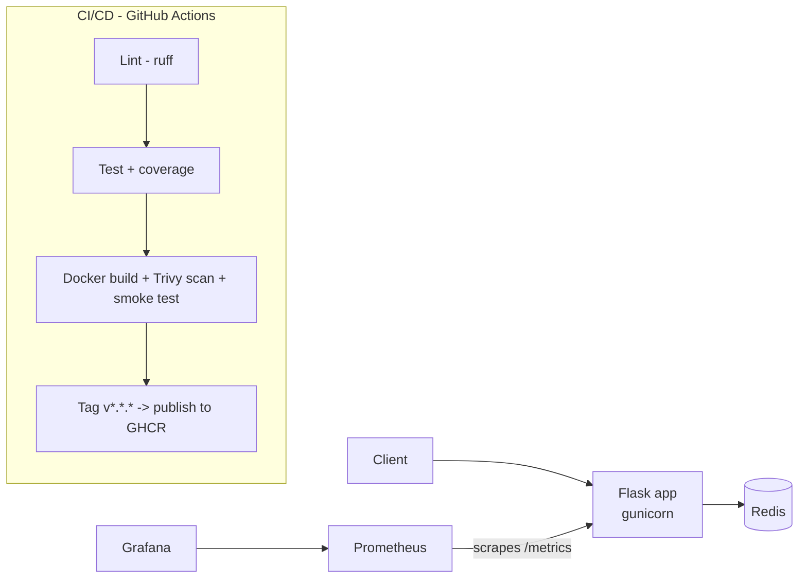

# docker-flask-demo


A small Python (Flask + Redis) service used to demonstrate a complete DevOps workflow:
containerization, CI/CD, security scanning, observability, and Kubernetes deployment.

## Architecture



## DevOps features

| Area | What's included |
|------|-----------------|
| Containers | Multi-stage Dockerfile, non-root user, `HEALTHCHECK`, `.dockerignore` |
| Orchestration | Docker Compose with service health checks and persistent volumes |
| CI | GitHub Actions: ruff lint/format, pytest with 80% coverage gate |
| Security | Trivy image scan in CI, Dependabot (pip, Docker, Actions), non-root container |
| CD | Tagging `v1.0.0` publishes the image to GitHub Container Registry |
| Observability | Prometheus metrics (`/metrics`), JSON structured logs, provisioned Grafana dashboard |
| Reliability | Separate liveness (`/health`) and readiness (`/ready`) endpoints |
| Kubernetes | Deployment, Service, HPA, probes, resource limits, security context (Kustomize) |
| Developer experience | Makefile, pre-commit hooks, `.env.example` |

## Quick start

Requires Docker Desktop (running).

```bash
make up          # or: docker compose up --build -d
make load        # generate some traffic
```

| Service    | URL                          |
|------------|------------------------------|
| App        | http://localhost:5000        |
| Metrics    | http://localhost:5000/metrics |
| Prometheus | http://localhost:9090        |
| Grafana    | http://localhost:3000 (admin / admin) -> dashboard "Flask App Overview" |

Stop everything with `make down`.

## API

| Method | Path       | Description                         |
|--------|------------|-------------------------------------|
| GET    | `/`        | Greeting, Redis hit counter, version |
| GET    | `/health`  | Liveness probe                      |
| GET    | `/ready`   | Readiness probe (checks Redis)      |
| GET    | `/metrics` | Prometheus metrics                  |
| GET    | `/todos`   | List todos                          |
| POST   | `/todos`   | Add todo `{"text": "..."}`          |

## Development

```bash
python -m venv .venv && source .venv/bin/activate   # Windows: .venv\Scripts\activate
make install
make lint
make test
pip install pre-commit && pre-commit install        # optional
```

## Kubernetes (local, with kind)

Requires [kind](https://kind.sigs.k8s.io/) and kubectl (Docker Desktop's built-in Kubernetes also works).

```bash
make k8s-up
kubectl -n demo get pods
kubectl -n demo port-forward svc/web 8080:80      # http://localhost:8080
make k8s-down
```

The HPA needs metrics-server installed in the cluster to scale.

## Releasing

```bash
git tag v1.0.0 && git push origin v1.0.0
```
The Release workflow publishes `ghcr.io/<your-username>/docker-flask-demo:1.0.0` and `:latest`.

## Ideas for next steps
- Terraform to provision a cloud cluster (EKS/GKE/AKS) or a VM
- Helm chart or Argo CD for GitOps deployment
- Loki for log aggregation, Alertmanager rules for the 5xx rate
- SBOM generation and image signing with cosign
